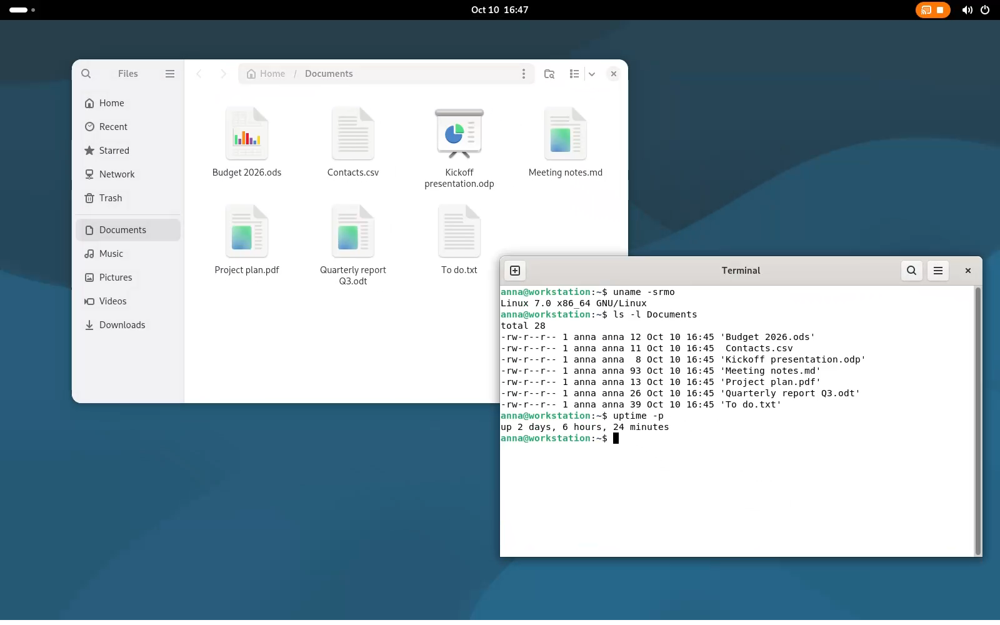

<p align="center"></p>

# REMOTIX

**Your Linux desktop in a browser tab.** REMOTIX runs on the Linux machine; you open its address in the
browser of a laptop, a phone or a tablet, sign in with your Linux user name and password, and your desktop
appears, as large as the window. There is nothing to install on the device you connect from.

<p align="center"></p>

- **Your own desktop**: one per user, several people on the same machine at the same time.
- **Leave and come back**: closing the tab does not close the desktop; sign in again, from any device, and
  your windows are where you left them.
- **Keyboard, mouse, touch, sound, and copy and paste** of text in both directions.
- **Encrypted**, on one port: 7447, TCP and UDP.

## Download

**REMOTIX 1.0.0**: [`remotix-1.0.0-1.run`](https://remotix.nicfio.it/download/remotix-1.0.0-1.run)
([SHA-256](https://remotix.nicfio.it/download/remotix-1.0.0-1.run.sha256)). One file holds the installer and
the packages for all seven distributions.

## Install

Copy the file to the Linux machine. First ask it what it thinks of the machine (read only, no administrator
rights, nothing is changed), then install:

```sh
sh remotix-1.0.0-1.run check
sudo sh remotix-1.0.0-1.run
```

It works like `apt`: it shows the plan, including the exact packages and the port —
`Port: 7447 (TCP+UDP) — use --port N to change it` — asks `Proceed? [y/N]` once, and only then acts.
Add `--port N` after the file name to use another port. The installer does not change the firewall: open
port 7447, TCP and UDP, yourself (`sudo ufw allow REMOTIX`, or
`sudo firewall-cmd --permanent --add-service=remotix` and `sudo firewall-cmd --reload`).

Then open `https://<machine>:7447` in a browser. The first time on each device the browser warns about the
certificate, which REMOTIX made itself: choose to continue.

The machine needs a 64-bit PC (x86_64) and **a graphics card that encodes video**: REMOTIX encodes the
picture only on the graphics card, never on the processor (Intel and AMD through VA-API; AMD and NVIDIA
through Vulkan Video, NVIDIA with the proprietary driver 550 or newer).

## Desktops

**GNOME**, **KDE Plasma**, **XFCE** and **LXQt** (GNOME 46, KDE Plasma 6.1, XFCE 4.20, LXQt 2.0 or newer),
already installed on the machine: REMOTIX does not install one. The remote desktop is a Wayland session;
X11 programs run through XWayland. XFCE and LXQt run on the labwc compositor; KDE Plasma runs inside a small
labwc that REMOTIX starts without a screen of its own, which lets the desktop take the size of a new window
when you come back (on AlmaLinux and RHEL 10, which have no labwc package, REMOTIX brings its own).

## Distributions

| Distribution | Version | Desktops | Compatible, not certified |
|---|---|---|---|
| Debian | 13 (Trixie) | GNOME, KDE Plasma, XFCE, LXQt | |
| Ubuntu | 26.04 LTS | GNOME, KDE Plasma, XFCE, LXQt | |
| Fedora | 44 | GNOME, KDE Plasma, XFCE, LXQt | |
| AlmaLinux | 10.1 (EPEL with CRB enabled) | GNOME, KDE Plasma | Rocky Linux, RHEL |
| Arch Linux | rolling | GNOME, KDE Plasma, XFCE, LXQt | Manjaro, EndeavourOS |
| openSUSE Tumbleweed | rolling | GNOME, KDE Plasma, XFCE, LXQt | |
| openSUSE Leap | 16.0 | GNOME, KDE Plasma¹, XFCE, LXQt | |

¹ On Leap 16, KDE Plasma needs a graphics card with 3D acceleration (or virgl in a virtual machine).

The installer refuses any other distribution. Out of scope: Debian 12, Ubuntu 24.04, RHEL 9 and its
rebuilds, openSUSE Leap 15, Linux Mint, distributions without systemd, immutable distributions.

## Browsers

The browser needs WebTransport and WebCodecs.

| Browser | Where | Status |
|---|---|---|
| Chrome, Edge and the other Chromium browsers | Linux, Windows | supported |
| Chrome | Android | supported |
| Firefox | Linux | supported |
| Firefox | Windows | not tested yet |
| Firefox | Android | not supported: it lacks WebCodecs |
| Safari | macOS, iOS | not tested yet |

## Documentation

- [User Manual](https://remotix.nicfio.it/docs/user-manual.html): installing, signing in, updating,
  uninstalling, where the logs are ([in the repository](docs/User%20Manual.html)).
- [Technical Manual](https://remotix.nicfio.it/docs/technical-manual.html): how REMOTIX works inside
  ([in the repository](docs/Technical%20Manual.html), sources in [`docs/sources/`](docs/sources/)).

## Licence

Free for personal use and for non-profit associations, churches and religious institutes; any other use needs
a written licence from the Author (**remotix@nicfio.it**). The source code is published so that it can be read
and checked: it may not be modified or redistributed. The terms are in [`LICENSE.md`](LICENSE.md); third-party
components keep their own licences, in [`THIRD-PARTY-LICENSES`](THIRD-PARTY-LICENSES).

## Reporting problems

[Open an issue](https://github.com/nic-fio/REMOTIX/issues/new) for a bug, a feature request or a question;
quote the installer's `RX-…` code if there is one. Pull requests are not accepted: the licence keeps every
change in the Author's hands. See [`CONTRIBUTING.md`](CONTRIBUTING.md).
